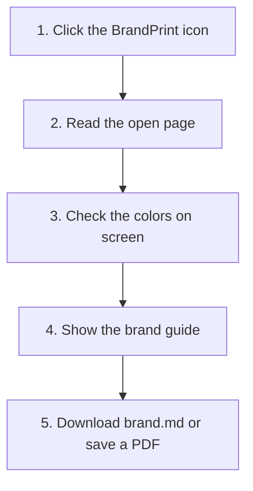

# BrandPrint

BrandPrint is a Chrome extension. Open any website, click the icon, and it reads the brand on that page: colors, type, buttons, spacing, and voice. Then you can download one `brand.md` file.

The read stays in your browser. BrandPrint has no account and no server.

BrandPrint is MIT licensed. See [LICENSE](LICENSE).

## Install

1. Open `chrome://extensions`.
2. Turn on **Developer mode**.
3. Click **Load unpacked** and choose this folder.
4. Open a normal website.
5. Click the BrandPrint icon.

The panel floats on the page. Use the expand icon to make it larger. After you update the extension, refresh the site and click the icon again.

## What happens when you click the icon

1. BrandPrint opens a panel on the page you are viewing.
2. It reads the colors, fonts, buttons, spacing, and words that are actually on screen.
3. It checks those colors against the page, so a color that only exists in the code is not treated as the brand.
4. The panel shows the guide.
5. You download `brand.md`, or save a PDF of the guide.

Read the page again after a site switches from dark to light. BrandPrint keeps the theme that is on screen at the moment you read it.

Photos and illustrations are not sampled. Only colors drawn with CSS are.

## What the panel shows

- **Overview.** Site name, short description, and a strip of the colors in use.
- **Palette.** The main colors. Click a swatch to copy it.
- **Gradients.** Only if the page uses them.
- **Typography.** The fonts and sizes on the page.
- **Buttons, space, corners.** Button style, spacing, and corner radius. The sample buttons say “Button” so a long label stays on one line.
- **brand.md.** One file for landing pages, social posts, slides, PDFs, and video.

`brand.md` is a starting point. Anything an AI tool builds from it is a first draft or a brainstorm. The result also depends on the model and the prompt. A designer still finishes the work.

## Privacy

No account. No upload of the page. Details are in [PRIVACY.md](PRIVACY.md).

## License

MIT License. Copyright (c) 2026 Mubasil.

The project link is on [mubasil.me](https://mubasil.me). Full terms are in [LICENSE](LICENSE).
