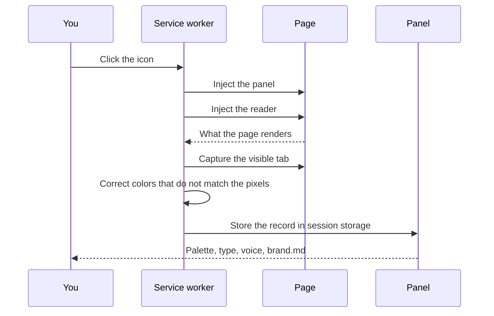

# BrandPrint

BrandPrint is a Chrome extension that reads the page you are on and writes a `brand.md` file from what is actually there. Colors, type, buttons, spacing, gradients, and voice stay in your browser. Nothing is sent to a server.

BrandPrint is released under the MIT license. See [LICENSE](LICENSE).

## Install

1. Open `chrome://extensions`.
2. Turn on **Developer mode**.
3. Click **Load unpacked** and choose this folder.
4. Open a normal website (`http` or `https`).
5. Click the BrandPrint icon.

Chrome blocks `chrome://` pages and, unless you allow it, `file://` pages. After you reload the extension, close the old panel and click the icon again. A panel that was already open cannot pick up the new code.

## What you see

The guide opens as a floating panel over the page.

- **Overview.** The site name, a short description, and a strip of the colors in use.
- **Palette.** Primary, secondary, tertiary, accents, and neutrals. Click a swatch to copy it.
- **Gradients.** Shown only when the page uses CSS gradients. The bar is on the left, the stops on the right.
- **Typography.** The fonts that actually load, and the type scale.
- **Buttons, space, corners.** Primary and secondary button styles, the spacing scale, and corner radii. The sample buttons say “Button” so a long label does not wrap.
- **brand.md.** Download or copy one file for landing pages, social posts, slides, PDFs, and video. Those assets are a v1 or a brainstorm. They also depend on the AI model and the prompt, not only on the file.

The expand control makes the panel almost full screen, with a small inset so text stays inside. Save PDF prints the same guide. The brand.md card stays black.

## How a read works

```mermaid
flowchart TD
  click[Click the BrandPrint icon] --> overlay[Open the panel on this page]
  click --> read[Read the live page in the tab]
  read --> record[Colors, type, buttons, space, gradients, copy]
  record --> shot[Screenshot the visible tab]
  shot --> check[Compare CSS colors with the pixels]
  check --> store[Keep the result for this browser session]
  store --> guide[Show the guide]
  guide --> md[Download or copy brand.md]
  guide --> pdf[Save a PDF]
```



The reader looks at rendered styles, not only at named CSS variables. A token counts when something visible uses it. Large fills rank above a tint that only appears in a heading. Colors that exist only inside a photo or an illustration are not sampled, because they are not CSS.

If a section is waiting on a scroll animation and is still transparent, the reader can still record a large opaque fill that is laid out on the page.

## What brand.md is for

`brand.md` holds the verified values, the voice, and rules for each format. Design tools and AI assistants can build from it.

The file is the spark, not a signed-off design. Treat anything generated from it as a v1, a quick draft, or a brainstorm. A designer still takes it to the finish. The result also depends on the model and the prompt.

## Permissions

| Permission | Why it is there |
| --- | --- |
| `activeTab` | Read only the tab you click. |
| `scripting` | Run the reader and open the panel on that tab. |
| `storage` | Keep the last read in `chrome.storage.session` until the browser session ends. |
| `downloads` | Save `brand.md` to your computer. |
| `sidePanel` | Declared so Chrome will not dock the guide in the side column. The icon opens the floating panel. |

## Project files

| Path | Role |
| --- | --- |
| `manifest.json` | Name, version, permissions. |
| `src/background.js` | Icon click, capture, session storage. |
| `src/overlay.js` | Floating panel and the expanded size. |
| `src/extract.js` | Reads the live page. |
| `src/verify.js` | Checks colors against a screenshot of the tab. |
| `src/analyze.js` | Voice and design language from the page copy. |
| `src/brandmd.js` | Writes `brand.md`. |
| `src/guide.html`, `guide.js`, `guide.css` | The guide you see. |
| `src/contrast.js`, `src/util.js` | Color math and small helpers. |
| `fixtures/landing.html` | A local sample page. |
| `LICENSE` | MIT license for BrandPrint. |
| `PRIVACY.md` | What stays on your machine. |

## Privacy

BrandPrint has no account and no backend. The page is read on your computer. Details are in [PRIVACY.md](PRIVACY.md).

## License

BrandPrint is MIT licensed. Copyright (c) 2026 Mubasil.

The source is published from Mubasil’s Git account. The link is on [mubasil.me](https://mubasil.me).

Full terms: [LICENSE](LICENSE).
